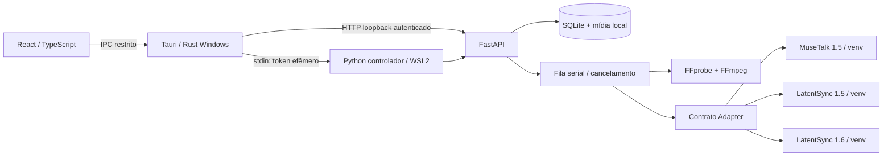

# Arquitetura e decisões

## Primeira abertura e atualização

A interface abre mesmo quando Python, FFmpeg e WSL ainda não estão preparados. `setup.rs` consulta os componentes do Windows e publica estado/logs reais para `SetupGate.tsx`. A habilitação WSL é acionada por um botão e usa a autorização de administrador do Windows; não há reinicialização forçada.

O backend fonte e o bootstrap são empacotados no executável por `build.rs`. O gerenciador baixa a imagem oficial Ubuntu, compara SHA-256 com o manifesto HTTPS oficial e importa a distribuição WSL2 `Mimisync-Ubuntu` em uma pasta própria do app. O bootstrap instala somente os pacotes necessários nesse ambiente e grava um marcador de versão ao concluir. A primeira conexão ao backend ainda exige um `/health` autenticado bem-sucedido; o marcador sozinho não abre o estúdio.

A operação de instalação de modelo executa ambiente e checkpoints em um único trabalho de fila. As operações separadas continuam na API para gerenciar/reparar checkpoints individualmente. Downloads e erros são reais; percentuais não são fabricados.

A API não recebe um executável, comando shell ou caminho de saída arbitrário do frontend. Cada adaptador monta uma lista de argumentos; subprocessos do gerenciador usam `shell=False`. Os motores oficiais contêm chamadas próprias ao shell, então os dados de inferência são copiados para caminhos controlados ASCII sem espaços/metacaracteres. Arquivos com nomes arbitrários são importados via stream Rust para IDs gerados no backend.

O backend escuta somente loopback e exige token aleatório em todas as rotas. O Rust gera o token por sessão e o envia por stdin, sem segredo em argv ou arquivo versionado. Reprodução de vídeo usa query token exclusivamente nas rotas de mídia/resultado; access logs da API ficam desativados. O frontend não faz chamadas a APIs externas e o CSP só autoriza mídia loopback e IPC. O cliente Rust não usa proxies para HTTP local. A sessão termina ao fechar stdin; a fila cancela subprocessos em andamento. O token não é uma barreira contra um usuário que já controla a mesma conta do sistema.

Uma única fila serializa instalações, remoções e renders para evitar conflitos de arquivos/VRAM. Trabalhos queued/running viram interrupted após reinicialização: não prometemos retomar uma inferência CUDA do ponto onde parou. O histórico e saídas ficam persistentes. Arquivos de entrada e intermediários permanecem no diretório de dados; ainda não há política automática de limpeza/limite de disco.

Progresso é indeterminado enquanto o processo não publica contadores. Percentuais extraídos de tqdm pertencem à etapa atual, não ao trabalho inteiro. A etapa de exportação só termina depois de FFprobe validar vídeo e áudio produzidos. MuseTalk captura exceções internamente, então também exigimos um arquivo de saída válido e duração coerente; um exit code zero sozinho não valida inferência.

Novos motores implementam o protocolo `Adapter.command`, adicionam metadados e requisitos ao catálogo e definem instalação/verificação de seus artefatos. Eles devem produzir um vídeo composto sobre frames completos. O sistema nunca usa uma cópia do original como fallback de inferência.

## Preservação de mídia

- Não há restauração facial generativa automática adicional.
- Os motores oficiais detectam/alinham a face e recompõem os frames; Mimisync não aplica uma máscara retangular fixa nem amplia uma face gerada como se fosse o frame original.
- MuseTalk recebe vídeo no FPS da preparação. LatentSync recebe 25 FPS porque seu pipeline usa essa cadência.
- Exportação usa dimensões, proporção de pixel e FPS médio original, H.264 yuv420p/AAC e áudio de entrada de maior qualidade (não o WAV mono 16 kHz de inferência).
- LatentSync não recupera a cadência original ao retornar de 25 FPS. Vídeos VFR são convertidos para CFR. O processamento e a exportação reencodificam o conteúdo; não são preservação bit a bit nem suporte HDR/10-bit.
- Dimensões ímpares são rejeitadas explicitamente nesta versão. Rotação complexa/HDR precisam de homologação adicional.
- A duração é a menor entre vídeo e áudio, menos o início selecionado. Não estendemos vídeos curtos repetindo a face silenciosamente.
- A/B usa o vídeo original com offset do início selecionado e o resultado local, sincronizados pelo relógio do resultado; mantém o original mudo para não duplicar som.
